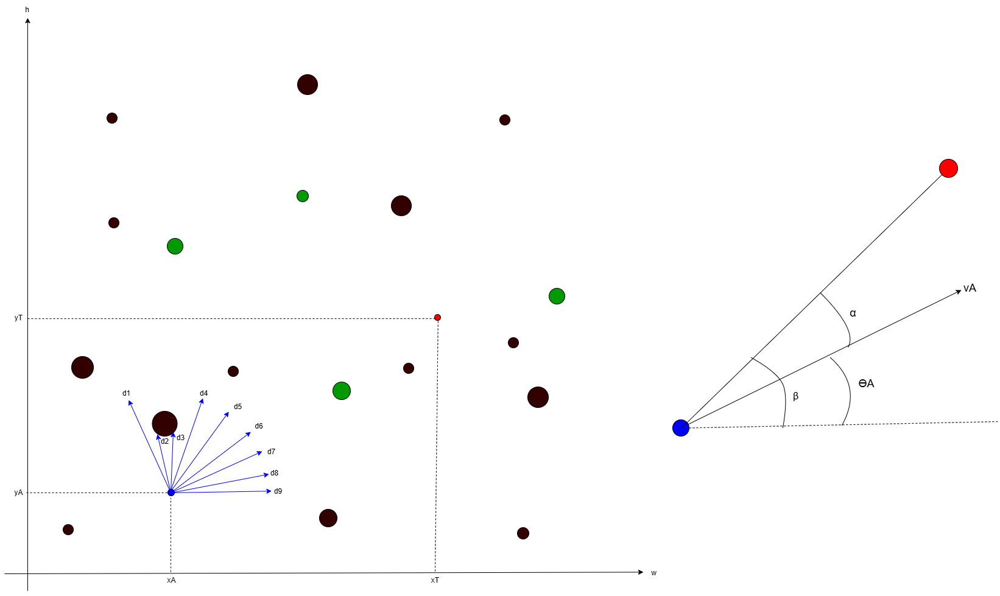
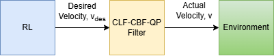

# Decoupled RL + CLF-CBF-QP Safety Filter for UAV Navigation

<p align="center">
  
  &nbsp;&nbsp;&nbsp;
  
</p>

> **A Decoupled Reinforcement Learning and Safety-Filter Architecture for Zero-Shot UAV Navigation in Dense Obstacle Environments**
>
> *Ashik Abrar Naeem and Mohammad Ariful Haque*
> — ICECE 2026

This repository contains the source code, pretrained models, and experimental configurations for our paper accepted at the **International Conference on Electrical & Computer Engineering (ICECE) 2026**.

---

## Overview

We propose a **two-stage architecture** for UAV navigation in dense obstacle environments:

1. **Stage 1 — Training:** A [Multiple-Pool TD3 (MPTD3)](assets/mptd3_architecture.png) agent is trained with *Potential-Based Reward Shaping (PBRS)*-inspired rewards in a randomized 2D simulation environment. The shaped rewards reduce average episode length by **~19.7%** compared to a heuristic baseline while maintaining comparable success rates.

2. **Stage 2 — Deployment:** The pretrained policy is wrapped with a **CLF-CBF-QP safety filter** at test time (zero-shot, no retraining), enabling deployment in denser, unseen workspaces with static and dynamic targets. The filter achieves **99% success** (static target) and **98% success** (dynamic target) in 100-episode tests.

### Key Results

| Method | Success | Collisions | Out-of-Bounds | Timeouts | Avg Steps |
|---|:---:|:---:|:---:|:---:|:---:|
| **Static Target** | | | | | |
| RL only (1 Hz) | 44 | 2 | 51 | 3 | 102.84 |
| RL + Decision (10 Hz) | 73 | 4 | 22 | 1 | 74.95 |
| RL + CLF-QP (10 Hz) | 75 | 24 | 1 | 0 | 52.93 |
| RL + CLF-CBF-QP (10 Hz) | **99** | **1** | **0** | **0** | 59.52 |
| **Dynamic Target** | | | | | |
| RL only (1 Hz) | 65 | 4 | 14 | 17 | 157.25 |
| RL + Decision (10 Hz) | 79 | 3 | 10 | 8 | 118.85 |
| RL + CLF-QP (10 Hz) | 59 | 38 | 3 | 0 | 45.88 |
| RL + CLF-CBF-QP (10 Hz) | **98** | **2** | **0** | **0** | 55.52 |

---

## Repository Structure

```
uav-navigation-rl-cbf/
├── envs/                           # Gymnasium environments
│   ├── enums.py                    # Shared enumerations
│   ├── uav_env.py                  # Base training environment (1000×1000)
│   ├── uav_env_with_filter.py      # CLF-CBF-QP filter environment (static target, 100×100)
│   ├── uav_env_with_filter_dynamic.py  # CLF-CBF-QP filter (dynamic target)
│   ├── uav_env_clf_qp.py          # CLF-QP only (no CBF)
│   ├── uav_env_decision.py        # Higher-rate decision only (no QP)
│   └── uav_env_rl_only.py         # RL only baseline in test env
├── scripts/
│   ├── train/                      # Training scripts
│   │   ├── train_proposed_reward.py    # Train with PBRS-inspired reward
│   │   └── train_baseline_reward.py    # Train with heuristic baseline reward
│   ├── test/                       # Evaluation scripts
│   │   ├── test_proposed_reward.py
│   │   ├── test_baseline_reward.py
│   │   ├── test_clf_cbf_qp_static.py  # Full filter, static target
│   │   ├── test_clf_cbf_qp_dynamic.py # Full filter, dynamic target
│   │   ├── test_clf_qp_static.py      # CLF-QP ablation
│   │   ├── test_decision_static.py    # Decision-rate ablation
│   │   └── test_rl_only_static.py     # RL-only ablation
│   └── visualize/                  # Visualization utilities
│       ├── visualize_trajectories.py
│       ├── average_reward.py
│       └── monitor.py
├── pretrained_models/              # Saved model checkpoints
│   ├── baseline_reward/
│   ├── proposed_reward/
│   └── proposed_reward_deterministic/
├── paper/                          # Published paper PDF
├── assets/                         # Figures for README
├── configs/                        # Hyperparameter configs
│   └── hyperparameters.md
├── requirements.txt
├── .gitignore
└── LICENSE
```

---

## Hyperparameters

All hyperparameters, reward weights, environment settings, and filter gains are documented in [`configs/hyperparameters.md`](configs/hyperparameters.md).

---

## Installation

```bash
git clone https://github.com/abrar-naeem11/uav-navigation-rl-cbf.git
cd uav-navigation-rl-cbf
pip install -r requirements.txt
```

### Requirements
- Python ≥ 3.9
- PyBullet 3.21
- Stable-Baselines3 2.7.0
- Gymnasium 1.1.1
- CVXPY (for QP solving)
- NumPy, Torch, Pandas

---

## Usage

### Training

```bash
# Train with proposed PBRS-inspired reward
python scripts/train/train_proposed_reward.py

# Train with baseline heuristic reward
python scripts/train/train_baseline_reward.py
```

### Evaluation

```bash
# Test the RL policy with CLF-CBF-QP filter (static target, 100×100 dense env)
python scripts/test/test_clf_cbf_qp_static.py

# Test with dynamic target
python scripts/test/test_clf_cbf_qp_dynamic.py

# Ablation: RL only
python scripts/test/test_rl_only_static.py

# Ablation: CLF-QP only (no CBF)
python scripts/test/test_clf_qp_static.py
```

### Visualization

```bash
python scripts/visualize/visualize_trajectories.py
```

---

## Method Summary

### PBRS-Inspired Reward Shaping

Three shaping terms derived from potential functions accelerate convergence:
- **Distance shaping** $\Phi_D(s) = -k_D \cdot d$ — rewards progress toward the goal
- **Alignment shaping** $\Phi_\Theta(s) = -k_\Theta \cdot |\alpha|$ — rewards heading alignment
- **Obstacle clearance** $\Phi_{\text{obs}}(s) = k_{\text{obs}} \sum d_i$ — rewards maintaining distance from obstacles

### CLF-CBF-QP Safety Filter

At deployment, the pretrained policy proposes a desired velocity $v_{\text{des}}$. The QP filter solves:

$$\min_{v, \delta_1, \delta_2} \frac{1}{2}\|v - v_{\text{des}}\|^2 + \frac{\lambda_{\text{slack}}}{2}(\delta_1^2 + \delta_2^2)$$

subject to CLF convergence, CBF obstacle avoidance (hard constraint), boundary CBFs, and velocity limits.

---

## Limitations

- Single training seed; results should be validated with multi-seed runs (mean ± std)
- Simplified 2D kinematic simulation with noiseless sensors
- Single-integrator velocity tracking at deployment (holonomic mismatch with training dynamics)
- Single-circle obstacle clustering may misrepresent complex multi-obstacle geometry
- Non-RL filter baselines (straight-to-goal, zero-command) not yet evaluated

---

## Citation

If you find this work useful, please cite:

```bibtex
@inproceedings{naeem2026decoupled,
  title     = {A Decoupled Reinforcement Learning and Safety-Filter Architecture 
               for Zero-Shot {UAV} Navigation in Dense Obstacle Environments},
  author    = {Naeem, Ashik Abrar and Haque, Mohammad Ariful},
  booktitle = {Proc. International Conference on Electrical \& Computer Engineering (ICECE)},
  year      = {2026}
}
```

## License

This project is licensed under the MIT License — see [`LICENSE`](LICENSE) for details.

## Contact

**Ashik Abrar Naeem** — [2006005@eee.buet.ac.bd](mailto:2006005@eee.buet.ac.bd) — [GitHub](https://github.com/abrar-naeem11)
